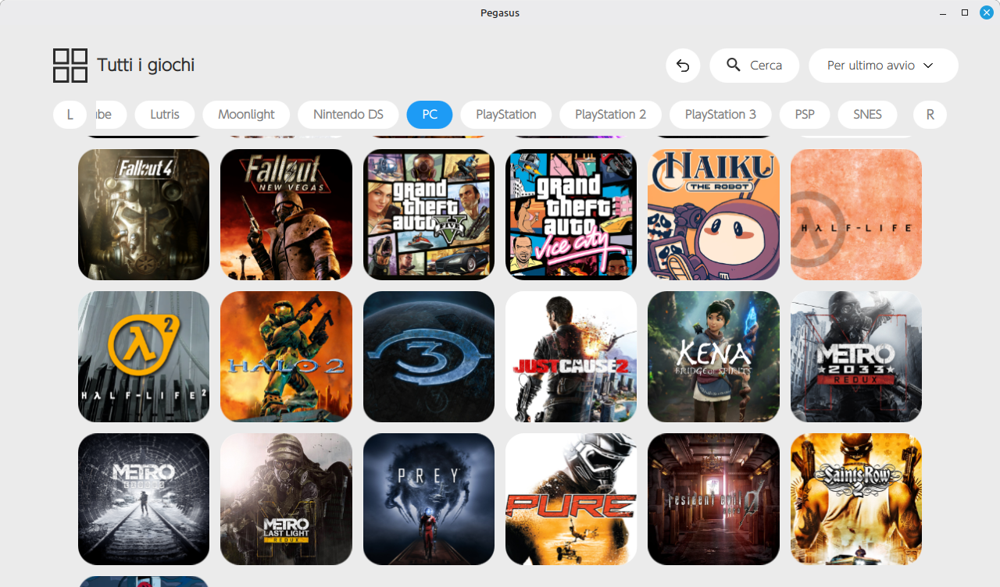
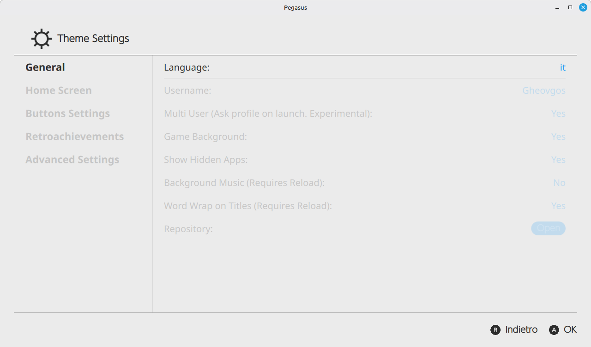
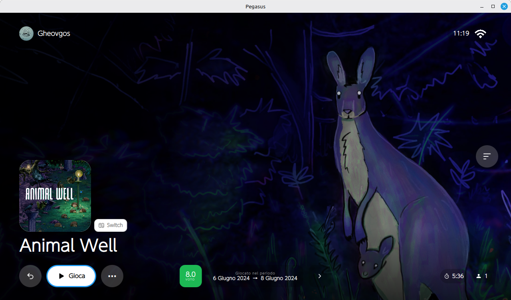
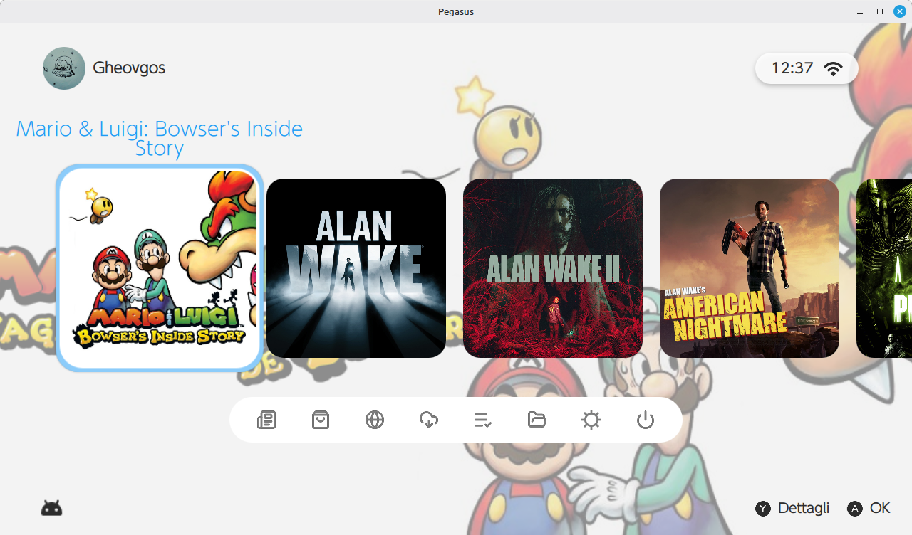

# Skyline OS 2

A clean and simple theme that aims to recreate the experience of Nintendo's Switch 2 console. SkylineOS 2 is a theme for [Pegasus Frontend](http://pegasus-frontend.org/) forked from SwitchOS (fork from RBertoCases/skylineOS).
With this theme, I don’t just want to replicate the Switch’s new style exactly, but I also want to see just how far we can “push” Pegasus, since I think it’s truly underrated. For example, integration with RetroAchievements, scraping from SteamGridDB, multi-user support, language selection, along with much more. Furthermore, as a personal project, I’d like it to be more than just a simple theme, I want it to serve as a personal catalog of titles we’ve played or have on our wishlist.

___

## Disclaimer

I want to make it clear that this started out as a project just to kill time; I didn’t know QML, so in the early stages I relied heavily on AI for help. But as development has progressed, I’ve been having a lot of fun; I’m learning how to master this tool, and my use of generative AI has dropped significantly. I’m against vibe coding; there’s definitely some “messiness” in the code, but I admit it helped me a lot in the beginning (without it, this fork probably would never have been created).

## Installation

Simply download the theme and place it in your [Pegasus theme directory](http://pegasus-frontend.org/docs/user-guide/installing-themes/) under a folder called skylineOS.

You can download the master repository and use it as theme

## Customization

I hate it when things aren't customizable, especially when it costs next to nothing to change them! What you see here is designed to be editable: from the buttons at the bottom to the images, from the descriptions to the settings:

- Light/dark theme: imported from the old fork, it does exactly what you'd expect...
- Username: you can set it as you like, or import it from RA
- Retroachievement: for now, it only downloads the image and username (and sets them automatically)
- Wi-Fi/battery icon
- Card size (warning: don’t go over 50, as it breaks for now! A settings reset needs to be implemented)
- Number of cards displayed on screen (default 12)
- Language: at the moment only English and Italian are supported. If you want to translate ot, you are welcome!
- Accent color
- "Satelittes" users: set your account as primary, then create "satellites" accounts to change user data before launch. This is, by design, must completed by you: the theme just set in the memory which user is running, then you must create your own script to do save-swap or other things. Read Pegasus Documentation for more. Here you can find an example script
- Background Scraping and transparency
- Hiding Apps & Games
- Bottom buttons, all of them are customizable!

## Usages

Buttons:
- To launch specific apps in bottom, put the URI path in the setting section. For example, if you are on android and want to launch MT insteand of default app Files, use "android-app://bin.mt.plus". If you dont like this feature, you can disable each button and/or replaced them, just change the text label and the svg icon
- To add games in backlog, add entries inside the backlog.json file. For example: [{ "title": "Example title" }. { "title": "Example title2" }]
- To customize the background of the button bar, place inside assets/images/, a file called menuButtonBackground.png. It will be loaded in the home screen
- To hide an application, press R1\D on Home Screen. To unhide, set to Yes on Show Hidden Apps, and press again R1\D on hidden games\apps
- RAWG Support! Use your API KEY to fetch data from RAWG databases
- Much more!

See [RELEASES.md](RELEASES.md) for full version history.
___

## Future

At the moment, I consider the app to be fairly stable. Of course, there are always a few bugs to fix or features to implement, and above all, some general optimization wouldn’t hurt. I definitely plan to implement these three things, though, one of which will definitely require a PR for Pegasus:

- Dual-Screen Support (PR)
- HowLongToBeat Support
- Exophase support

While I’m working on these three features (listed, for me, in order of importance), I’ll be releasing a few minor updates.
___

## Attributions

- SVGs: [Lucide.dev](https://lucide.dev/icons/globe)
- Author: [Zacksly](https://zacksly.itch.io)
- Another author: RBertoCases/skylineOS
- Source: https://zacksly.itch.io/switch-button-icons-and-controls
- License: [CC BY 3.0](https://creativecommons.org/licenses/by/3.0/)

 
